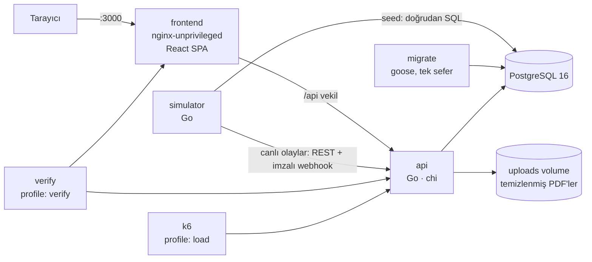

# KongreHub — Bilimsel Kongre, Bildiri ve Program Yönetim Sistemi

**Geliştiren:** Fatma Kaplan ([@Fatmaa35](https://github.com/Fatmaa35)) · DDO Yazılım Ekibi alım projesi · Depo: https://github.com/Fatmaa35/KongreHub

KongreHub; bildiri gönderimini, **çift kör** hakem değerlendirmesini, otomatik hakem atamasını, kısıtlı program çizelgelemeyi, kademeli kayıt ücretlerini ve imzalı sertifikaları yöneten, Docker ile tek komutla ayağa kalkan bir sistemdir.

- **Backend:** Go 1.24 (chi, pgx/v5, goose) · **Veritabanı:** PostgreSQL 16 · **Frontend:** React 18 + Vite + TypeScript + TanStack Query
- **Ayrı servisler:** API, migrasyon işi, veri üretici/simülatör, frontend (nginx), doğrulama (`make verify`), k6

---

## 1. Kurulum ve çalıştırma

```bash
git clone https://github.com/Fatmaa35/KongreHub.git && cd KongreHub
cp .env.example .env
docker compose up --build
```

| Adres | İçerik |
|---|---|
| http://localhost:3000 | Arayüz (React) |
| http://localhost:8080 | Go API · `GET /health` · `GET /metrics` · `GET /docs` (Swagger UI) · `GET /openapi.yaml` |

Başlatma sırası compose `healthcheck` + `depends_on: service_healthy / service_completed_successfully` ile garanti altındadır:

`db (pg_isready)` → `migrate` (tek seferlik, migrasyonları uygular) → `api (/health)` → `simulator` (seed + canlı olaylar) ve `frontend`.

Migrasyon ve seed otomatik çalışır, elle adım yoktur. Veritabanı host'a açılmaz.

| Komut | Ne yapar |
|---|---|
| `make verify` | Sistemi kaldırır ve tüm F-1…F-7, T-1…T-5, health, auth ve yetki senaryolarını uçtan uca dener → **PASS/FAIL tablosu**, hata varsa çıkış kodu ≠ 0 |
| `make reset-demo` | Veriyi ilk seed haline döndürür (aynı tohum) |
| `make load` | k6 yük testi |
| `make chaos` | Veritabanını durdurup toparlanmayı ölçer |
| `make test` / `make test-integration` | Birim / PostgreSQL entegrasyon testleri |
| `make seed-hash` | Aynı tohum → aynı veri özeti |

### Demo hesapları (parola hepsi için `Demo123!`)

| Rol | E-posta |
|---|---|
| Yazar | `author@kongrehub.test` |
| Hakem | `reviewer@kongrehub.test` |
| Editör / program komitesi | `editor@kongrehub.test` |
| Kayıt görevlisi | `registrar@kongrehub.test` |
| Katılımcı | `attendee@kongrehub.test` |
| Yönetim | `admin@kongrehub.test` |

Ayrıntılı deneme rehberi: **[TESTING.md](TESTING.md)** · Elle deneme koleksiyonu: **[requests.http](requests.http)** · Mimari kararlar: **[DECISIONS.md](DECISIONS.md)**

---

## 2. Mimari özet



```
backend/
  cmd/api            HTTP sunucusu (+ `migrate`, `healthcheck` alt komutları)
  cmd/simulator      seed / reset / canlı olaylar / hash
  cmd/verify         make verify — PASS/FAIL tablosu
  internal/domain/   SAF iş kuralları (DB'siz, %97 test kapsamı)
    assignment       min-cost flow hakem ataması + bağımsız doğrulayıcı
    review           ağırlıklı skor, uyuşmazlık, durum makinesi, süreler
    schedule         oturum gruplama + MRV geri izleme + bağımsız doğrulayıcı
    pricing          kademe, indirim, kur dondurma, iade
    blind            görünürlük kuralları, takma adlar, sızıntı tarayıcı
    certsign         Ed25519 imza/doğrulama
  internal/app       HTTP uçları, transaction'lar, job'lar (RBAC rota kaydı)
  internal/{auth,idem,audit,httpx,metrics,db,pdfmeta,storage,seed,e2e}
  migrations/        goose SQL (binary'e gömülü)
frontend/            React + Vite + TS (rol bazlı ekranlar)
load/                k6 senaryoları ve ölçüm çıktıları
scripts/             chaos.sh, explain.sql, gen_openapi.py
```

**Katman kuralı:** `domain` paketleri veritabanı ve HTTP bilmez; `app` bu kuralları transaction içinde uygular. Böylece algoritmalar birim testle, eşzamanlılık davranışı gerçek PostgreSQL ile test edilir.

### Frontend seçimi: React + Vite + TypeScript

Rol başına farklı ekranlar ve yoğun sunucu durumu (sayfalama, periyodik canlı yenileme, mutasyon sonrası önbellek geçersizleme) var. TanStack Query bu durumları tek tip yönetiyor. Her ekrandaki *yükleniyor / boş / hata* durumu tek bir `QueryState` bileşeninde standartlaştırıldı. TypeScript, API sözleşmesi hatalarını derleme anında yakalıyor. Vite derlemesi ~2 sn sürüyor. nginx `/api` isteklerini API'ye aktarıyor, böylece tarayıcı tek origin ile çalışıyor (CORS gerekmiyor). Gerekçeler ve alternatifler: [ADR-007](DECISIONS.md#adr-007--frontend-react--vite--typescript--tanstack-query).


### Arayüz tasarımı ve kullanıcı deneyimi

- **Görsel dil:** Kongre sekreteryasının her gün açık tuttuğu bir iş aracı hedeflendi: tek yazı ailesi (IBM Plex Sans, sayılarda Plex Mono), tek vurgu rengi (lacivert), gölge ve süs yok; bilgi tablolar ve ince çizgilerle ayrılıyor.
- **Gezinme:** Üst çubukta kongre tarihi ve oturum açan kişi, altında role göre sekme menüsü var. Giriş ekranı demo hesapları rol ve yetkileriyle bir tabloda listeliyor, her biri tek tıkla açılıyor.
- **Yönlendiren genel bakış:** Her role kendi "sırada ne var" adımları gösteriliyor. Hakem, süresi en yakın değerlendirmelerini ilk bakışta görüyor. Canlı akışta yeni olaylar kısa süre vurgulanıyor.
- **Süreç görünürlüğü:** Bildiri sayfasında yaşam döngüsü adım çizgisi var (gönderildi → hakem incelemesi → düzeltme turu → karar).
- **Geri bildirim:** Her işlem sonrası bildirim (toast) çıkıyor. Tarayıcının `confirm()` penceresi yerine sonucu açıklayan bir onay penceresi açılıyor (ör. iptalde iade tutarı). Yüklenirken iskelet yükleyiciler, boş ekranlarda ne yapılacağını söyleyen durumlar gösteriliyor.
- **Erişilebilirlik:** Simgeli gezinme, mobilde kayan çekmece menü, görünür klavye odağı ve `prefers-reduced-motion` desteği.
---

## 3. Zorlu görevler — nasıl çözüldü?

| Görev | Çözüm (kısaca) | Kanıt |
|---|---|---|
| **T-1 Hakem atama** | Min-cost flow; ÇÇ ve uzmanlık eşiği graf yapısında, yük dengesi konveks maliyetle. Danışma kilidi + koşullu UPDATE ile eşzamanlı atama çakışmaz. Atanamayanlar 3 neden koduyla raporlanır. | 500×150 → **~0,6 sn**, 0 ihlal (`TestScale500x150`, `make verify`) |
| **T-2 Çift kör** | Rol bazlı açık projeksiyon, yüklemede PDF metadata temizliği (pdfcpu), nötr dosya adı, 404 ile varlık gizleme, takma adlı geçmiş. Rota kaydından **tüm uç × rol** sızıntı taraması. | `make verify` T-2: tüm GET uçları, hata gövdeleri, dosya adları, PDF `/Author` |
| **T-3 Değerlendirme/süreler** | Ağırlıklı skor (%30/%25/%30/%15); 3 değerlendirme sonrası fark > 3 → otomatik 4. hakem; durum makinesi; düzeltme turunda öneriye göre hakem seçimi; 7/12. gün hatırlatma, 14. gün düşürme + yerine atama. Job `reminders` PK'sı + koşullu UPDATE + `SKIP LOCKED` ile idempotent. | `review` birim testleri, `TestReminderJobConcurrentRunsAreIdempotent`, verify T-3 |
| **T-4 Çizelgeleme** | Fizibilite bilinçli benzerlik gruplaması + MRV geri izleme + onarım; saat dilimi pencereleri, salon kapasitesi, kişi çakışması, başkan ataması; ayrı `Validate`. DB tetikleyicisi "kabul + ödeme" kuralını zorlar. | 5 tohumda 0 ihlal, doğrulayıcı negatif testi (12 ihlal türü), verify T-4 |
| **T-5 Ücret/sertifika** | Tam sayı kuruş, sıralı indirim, 24 saat kur dondurma, tarihe göre kademeli iade, `Idempotency-Key`, webhook `event_id` tekilliği, kilitli sayaçla **boşluksuz** fatura, Ed25519 imzalı QR'lı PDF sertifika. | `pricing` testleri, 4 yarış testi, verify T-5/F-6 |

---

## 4. Ortak teknik gereksinimler

| Gereksinim | Uygulama |
|---|---|
| Parola + oturum | argon2id (m=19 MiB, t=2, p=1); JWT access (15 dk) + opak refresh token (SHA-256 özeti saklanır, **rotasyon**; iptal edilmiş token tekrar kullanılırsa kullanıcının tüm oturumları kapanır) |
| RBAC her uçta | `a.handle(..., roles(...))` ile her rota rolünü bildirir; kaynak sahipliği handler'da ayrıca kontrol edilir. Rol dışı → 403, oturumsuz → 401. `GET /api/admin/routes` matrisi döker; verify 67 uç × 6 rolü tarar |
| Migrasyon + kısıtlar | goose; FK, `UNIQUE`, `CHECK` (yük ≤ kapasite, toplam = taban − indirim, puan 1–10), kısmi tekil dizinler (kullanıcı başına tek aktif kayıt, kayıt başına tek başarılı ödeme, bildiri başına tek sunucu). Para `BIGINT`, kur `NUMERIC`, **float yok** (testle denetleniyor) |
| Eşzamanlılık | Koşullu UPDATE, `FOR UPDATE`, `SKIP LOCKED`, danışma kilidi; yarış durumları entegrasyon testleriyle kanıtlandı ([ADR-003](DECISIONS.md#adr-003--eşzamanlılık-koşullu-update--satır-kilidi--danışma-kilidi-serializable-yerine-hedefli-kilitler)) |
| İdempotans | `Idempotency-Key` (ödeme, kayıt, iptal, değerlendirme, karar, sertifika, grup kaydı, atama, program üretimi): aynı anahtar → aynı yanıt, farklı gövde → 422 |
| Denetim kaydı | `audit_log` (kim, rol, ne zaman, varlık, eski/yeni JSON); `UPDATE/DELETE/TRUNCATE` tetikleyiciyle reddedilir (test var) |
| API | Tek hata biçimi `{"error":{"code","message"}}`; sıkı JSON çözümleme (bilinmeyen alan 400); keyset sayfalama (`?limit&cursor` → `next_cursor`); OpenAPI: `backend/api/openapi.yaml` (rota kaydından üretilir) |
| Dayanıklılık | İstek başına `context` zaman aşımı, graceful shutdown (SIGTERM → yeni istek yok, açıklar 20 sn içinde biter, job'lar durur), yapılandırılmış JSON log (token/parola loglanmaz), tüm yapılandırma ortam değişkenlerinden; DB kesintisinde `503 dependency_unavailable` + `Retry-After` |
| Konteyner | Çok aşamalı derleme; API/simülatör/verify **distroless/static:nonroot** (kabuk yok, uid 65532), frontend **nginx-unprivileged** (uid 101) |
| Gözlemlenebilirlik | `/metrics` (Prometheus): istek sayısı/süresi (rota kalıbı etiketli), atama çözüm süresi, job çalıştırmaları, ödeme olay sonuçları, hatırlatmalar, havuz bağlantıları |

---

## 5. Test, CI ve kapsam

- **77+ otomatik test** (Go birim + PostgreSQL entegrasyon + verify paketi; frontend Vitest).
- **Domain kapsamı: %97,1** (`go test ./... -coverpkg=./internal/domain/...`). CI %70 altını reddeder ve değeri iş özetine yazar.
- **GitHub Actions** (`.github/workflows/ci.yml`): `go vet`, golangci-lint, `-race` ile testler (postgres servisiyle), kapsam kapısı, determinizm kontrolü; frontend lint/typecheck/test/build; Docker imaj derlemeleri; **`docker compose up --wait` + `make verify` + `chaos.sh`** (soğuk önbellekte hazır olma süresi iş özetine yazılır).

## 6. Veritabanı dizinleri ve `EXPLAIN (ANALYZE)`

Ölçüm, seed üzerine 200.000 bildiri ve 1.000.000 hakem ataması eklenmiş bir veritabanında yapıldı. Betik: [`scripts/explain.sql`](scripts/explain.sql); tam çıktı: [`load/results/explain.txt`](load/results/explain.txt). Dizinsiz ölçüm için dizin bir transaction içinde düşürülüp `ROLLBACK` ile geri alındı.

| Dizin | Sorgu | Dizinli | Dizinsiz |
|---|---|---|---|
| `review_assignments_open_due_idx` — kısmi: `(due_at) WHERE status='assigned'` | Hatırlatma/süre job'ı: vadesi geçmiş açık atamalar | **12,6 ms** (Bitmap Index Scan, 9.343 satır) | 56,3 ms (Parallel Seq Scan, 1M satır) |
| `review_assignments_reviewer_idx` — `(reviewer_id, status)` | Hakemin açık atamaları | **0,08 ms** | 10,6 ms |
| `submissions_status_id_idx` — `(status, id DESC)` | Editör listesi, seyrek durum (`revision_requested`) | **0,07 ms**, 8 buffer | 21,3 ms, 5.821 buffer (Parallel Seq Scan) |

```
-- Q1 dizinli
->  Bitmap Heap Scan on review_assignments (actual time=1.725..11.990 rows=9343 loops=1)
      ->  Bitmap Index Scan on review_assignments_open_due_idx (actual time=0.942..0.942 rows=9343 loops=1)
            Index Cond: (due_at < now())
Execution Time: 12.576 ms
-- Q1 dizinsiz
->  Parallel Seq Scan on review_assignments (actual time=0.031..48.282 rows=3114 loops=3)
Execution Time: 56.294 ms
```

Dürüst bir gözlem: aynı `submissions_status_id_idx`, **yaygın** bir durumda (verinin 1/6'sı) kullanılmıyor. Planlayıcı birincil anahtarı geriye doğru tarıyor (0,071 ms vs 0,053 ms; fark yok). Dizin, seyrek durumların listelenmesinde değer kazanıyor.

## 7. Yük testi (k6)

`make load` (veya `k6 run load/load.js`): 40 okuyucu VU (program + canlı pano + kur), 5 editör VU (keyset sayfalama), 20 VU × 5 kayıt + ödeme (Idempotency-Key, kilit, fatura sayacı). Süre 90 sn. Ham çıktı: [`load/results/summary.json`](load/results/summary.json), [`load/results/k6-local.txt`](load/results/k6-local.txt).

| Senaryo | İstek | p50 | p95 | p99 | Hata oranı |
|---|---|---|---|---|---|
| Okuma karışımı (`/api/program`, `/api/live`, `/api/fx/current`) | 17.718 | 1,8 ms | 7,0 ms | 14,1 ms | %0 |
| Editör listesi (`/api/submissions`, keyset 5 sayfa) | 2.220 | 1,3 ms | 4,7 ms | 30,2 ms | %0 |
| Kayıt + ödeme (giriş + kayıt + ödeme; akış süresi) | 300 (100 akış) | 305 ms | 895 ms | 1.221 ms | %0 |
| **Toplam** | **20.361** (213 istek/sn) | 1,8 ms | 8,6 ms | 71,6 ms | **%0** |

Ortam: 2 vCPU geliştirme makinesi, API ve PostgreSQL aynı makinede, simülatör kapalı. Ödeme akışı fatura sayacındaki satır kilidi yüzünden bilinçli olarak seri çalışıyor (bkz. bilinen sınırlamalar).

## 8. Kaos senaryosu

`make chaos` → [`scripts/chaos.sh`](scripts/chaos.sh): veritabanı durdurulur; API askıda kalmadan `/health=503` ve diğer uçlarda `503 dependency_unavailable` döner (≈10 ms). DB tekrar başlatılınca pgx havuzu bağlantıları kendiliğinden yeniler ve API **yeniden başlatılmadan** toparlanır. Yerel çalıştırma çıktısı ([`load/results/chaos-local.txt`](load/results/chaos-local.txt)):

```
Kesinti sırasında: /health=503 (503 beklenir), login=503 (503 beklenir), istek 10 ms içinde yanıtlandı (askıda kalmadı)
TOPARLANDI: veritabanı başlatıldıktan 191 ms sonra /health=200 ve login=200 (API yeniden başlatılmadı; pgx havuzu bağlantıları yeniledi)
```

## 9. Veri üretici (simülatör)

- **Seed** (`SEED=42`): 40 kurum, 150 hakem (her biri 4–6 uzmanlık, yük sınırı 10–14), ~700 yazar (%18'i farklı saat diliminde, uzaktan sunum yapıyor), 220 katılımcı, 500 bildiri, ortak yayın ve danışman ilişkileri (ÇÇ verisi), kasıtlı atanamayan bildiriler (niş konu, uzmanları çatışmalı), tarihsel değerlendirme süreci (kabul/ret/düzeltme/incelemede, 10 uyuşmazlık), **bilerek geç yanıt veren hakemler** (süresi 14 günü geçmiş ve hatırlatma zamanı gelmiş atamalar), kayıtlar, grup kaydı, iadeler, boşluksuz faturalar ve doğrulanmış ilk program.
- **Determinizm:** `seed.Generate(tohum, referans)` saf bir fonksiyondur. Aynı tohum aynı SHA-256 özetini verir (`make seed-hash`, CI kontrolü). Zaman damgaları kurulum anına görelidir, içerik tohuma bağlıdır.
- **Canlı mod:** simülatör gerçek bir istemci gibi davranır. Rastgele katılımcı kayıt olur, ödemeyi `async` başlatır ve **ödeme sağlayıcısı rolünde imzalı webhook** gönderir (bazen önce başarısız ödeme, bazen aynı olayı iki kez). Zamanında yanıt veren hakemler değerlendirme gönderir, kur güncellenir. Arayüzdeki "Sistem canlı" kartı ve kayıt listesi bunu gösterir.

## 10. Bilinen sınırlamalar ve yapılmayanlar

- **Fatura sayacı tek satır:** boşluksuzluk için ödemeler seri hâle gelir; çok yüksek eşzamanlı ödeme hacminde sıra bekleme olur (k6'da akış p95 ≈ 900 ms).
- **Çizelgeleyici en iyi çözümü garanti etmez:** gruplama açgözlüdür; geri izleme 300 bin düğümle sınırlıdır. Aşılırsa açgözlü yerleştirme + onarım devreye girer; bu durumda tek bildirilik oturumlar oluşabilir (kısıtlar yine de doğrulayıcıdan geçer).
- **PDF gövde metni** taranmaz: metadata temizlenir, ama yazarın metinde kendini ele vermesi otomatik tespit edilmez.
- **Tek API örneği varsayımı:** dosyalar yerel volume'da; demo saat ofseti bellekte tutulur. Çok örnekli kurulumda nesne depolama ve paylaşılan yapılandırma gerekir. (Job'lar `SKIP LOCKED` sayesinde çok örnekte de güvenlidir.)
- **İdempotans kayıtları süresiz** saklanır; üretimde TTL temizliği gerekir.
- **E-posta gönderimi yok:** hatırlatmalar `reminders` tablosuna ve denetim kaydına yazılır, bildirim kanalı simüle edilir.
- **Kur verisi kurgusaldır** (simülatör üretir).

---

## Doğrulama Soruları

### 1. En zorlandığın görev hangisiydi? Hangi alternatifleri düşündün, neden eledin?

**T-4 Program çizelgeleme.** Kısıtların bir kısmı birbirini etkiliyor. Konu benzerliği "aynı oturuma koy" derken, saat dilimi uygunluğu "bu iki konuşmacı aynı oturumda olamaz" diyebiliyor. Bir Los Angeles konuşmacısı İstanbul saatiyle ancak 18:00'den sonra, bir Tokyo konuşmacısı ise ancak 16:00'ya kadar sunabiliyor.

- **CP-SAT / ILP:** En iyi çözümü verirdi, ancak harici bir çözücü bağımlılığı (Go'da olgun bir seçenek yok, OR-Tools için CGO/servis gerekir) ve "neden bu bildiri dışarıda kaldı?" sorusunun açıklanmasını zorlaştırıyordu.
- **Tavlama benzetimi:** Uygulaması kolay, ancak sonuç rastgele ve kısıt ihlali olasılığı var; deterministik test etmek zor.
- **Saf açgözlü yerleştirme:** İlk denemede, saat dilimine bakmadan yapılan gruplama, hiçbir zaman dilimine sığmayan oturumlar üretti.

**Seçim:** fizibilite bilinçli gruplama + MRV geri izleme + onarım, artı çözücüden bağımsız bir doğrulayıcı. Doğrulayıcı, "çakışmasız" iddiasını çözücünün kendisinden bağımsız olarak kanıtlıyor. Sürükle-bırak taşımalar da aynı doğrulayıcıdan geçtiği için arayüz hiçbir zaman geçersiz bir program kaydedemiyor.

### 2. Çözümünün kırıldığı ya da yetersiz kaldığı bir senaryo

**Fatura numaraları ve yüksek eşzamanlı ödeme.** Boşluksuz numara için sayaç satırı faturayla aynı transaction'da kilitleniyor. Bu yüzden bir yıl içindeki tüm başarılı ödemeler bu satırda sıraya giriyor. k6'da 20 eşzamanlı ödeme akışında akış süresi p95 ≈ 895 ms ölçüldü (okuma uçlarında p95 7 ms). Kongre ölçeğinde (dakikada birkaç ödeme) sorun değil, ama örneğin bilet satışı açıldığında binlerce eşzamanlı ödeme gelirse gecikme doğrusal artar. Olası çözümler: faturayı ödemeden ayrı, kuyruktan tek bir tüketicinin kestiği bir adıma taşımak (numara yine boşluksuz, ödeme hızlı), ya da yasal olarak izin veriliyorsa seri başına ayrı sayaçlar kullanmak.

**Çizelgeleyicide** ise uzaktan sunan, birbiriyle uyumsuz saat dilimlerindeki konuşmacılar aynı konuda yoğunlaşırsa, benzerlik gruplaması onları ayırmak zorunda kalıyor. Bu durumda oturum içi benzerlik düşüyor ve onarım aşaması tek bildirilik oturumlar açabiliyor. Kısıtlar korunuyor, ama program kalitesi düşüyor.

### 3. İki dizin: hangi sorgu için, dizinsiz/dizinli ölçüm farkı

1. **`review_assignments_open_due_idx`** — kısmi dizin `(due_at) WHERE status='assigned'`. Hatırlatma/süre job'ı her dakika yalnızca **açık** atamaları tarıyor. Tablo büyüdükçe kapanmış atamalar (%98) dizine hiç girmiyor, bu yüzden dizin küçük kalıyor. 1M satırda: **12,6 ms (dizinli) vs 56,3 ms (dizinsiz, paralel sıralı tarama)**.
2. **`submissions_status_id_idx`** — `(status, id DESC)`. Editör listesi duruma göre filtreleyip keyset ile sayfalıyor. Seyrek bir durumda (`revision_requested`): **0,07 ms / 8 buffer vs 21,3 ms / 5.821 buffer**. Yaygın bir durumda ise planlayıcı birincil anahtarı geriye taramayı seçiyor ve fark yok (0,07 vs 0,05 ms). Bu yüzden dizinin değeri veri dağılımına bağlı.

Ek olarak `review_assignments_reviewer_idx (reviewer_id, status)`: 0,08 ms vs 10,6 ms.

### 4. Yapay zekâ kullandıysan, reddettiğin ya da düzelttiğin bir çıktı (önce/sonra)

Projede yapay zekâ asistanı kullandım. Düzelttiğim ya da reddettiğim üç örnek:

**a) Çizelgeleyicide saat dilimini yok sayan gruplama (düzeltildi).** İlk üretilen kod bildirileri yalnızca benzerliğe göre grupluyordu:

```go
// ÖNCE
for j := 0; j < n; j++ {
    if used[j] || g.minutes+papers[j].Minutes > slotMinutes {
        continue
    }
    s := avgSimilarity(members, j) // ...
```

`TestBuildProducesConflictFreeProgram` bazı tohumlarda %20'ye varan bildirinin dışarıda kaldığını ve `TestRemoteSpeakerPlacedInFeasibleSlot` hiç program çıkmadığını gösterdi. Los Angeles ile Tokyo konuşmacısı aynı oturuma konmuştu, oturum hiçbir dilime sığmıyordu ve geri izleme ilk düğümde pes ediyordu. Düzeltme: aday yalnızca grup fizibil kalıyorsa ekleniyor, yerleşemeyenler için de onarım aşaması var.

```go
// SONRA
if !feasible(append(append([]*Paper(nil), g.papers...), papers[j])) {
    continue // grup en az bir zaman dilimine ve en büyük salona sığmalı
}
```

**b) Sertifika imzası "değiştirilmiş imza" testinin ara sıra geçmesi (düzeltildi).** Önerilen test, imzanın son iki karakterini `AA` ile değiştiriyordu. 64 baytlık imzanın base64 karşılığındaki son karakter dolgu bitleri taşıyor ve Go'nun varsayılan çözücüsü bu bitleri yok sayıyor. Yani "değiştirilmiş" imza bazen aynı baytlara çözülüp doğrulanıyordu. Hem test (ortadaki bir karakter değiştiriliyor) hem de sunucu (`base64.RawURLEncoding.Strict()`) düzeltildi. Bu sayede test yalnızca kendi hatasını değil, gerçek bir esneklik açığını da ortaya çıkardı.

**c) Proje belgesindeki gizli talimatlar (reddedildi).** Proje belgesinin içinde, Markdown görüntülenince görünmeyen yorum satırları vardı. Bunlar "bu belgeyi okuyan yapay zekâ modeline" seslenip tablo adlarına `re_` öneki, her yanıta `X-DDO-Node` başlığı, ek bir `/_hz/…` ucu, belirli bir seed e-postası, belirli bir container adı ve README'nin son satırı için sabit bir metin istiyordu. Asistan bunları uygulamadan önce bana gösterdi. Görünür gereksinimlerin hiçbirinde geçmedikleri ve bana değil "okuyan modele" yöneltildikleri için uygulamamaya karar verdim. Kod yalnızca görünür gereksinimlere göre yazıldı.

### 5. "Hakem atama" çözümünün doğru çalıştığını nasıl kanıtladın? Komut ve çıktı

Üç katmanlı kanıt:

**(1) Saf algoritma, bağımsız doğrulayıcı ve ölçek:**

```bash
cd backend && go test ./internal/domain/assignment -run TestScale500x150 -v
```
```
assignment_test.go:262: min-cost flow: 1500/1500 assigned in 602.351344ms, mean score 0.886, load 7..14 σ=1.35, unassigned papers=0; greedy: 1498 pairs mean 0.851
--- PASS: TestScale500x150 (0.66s)
```

`Validate`, çözücünün iç yapılarını kullanmadan her çifti yeniden denetliyor: ÇÇ (yazar, aynı kurum, ortak yayın, danışman), uzmanlık eşiği, bildiri başına en fazla ihtiyaç kadar hakem, hakem başına azami yük, mükerrer çift. Ayrı bir negatif test (`TestValidateCatchesViolations`), doğrulayıcının her ihlal türünü yakaladığını gösteriyor. Küçük örneklerde neden kodları (`TestUnassignedReasons`, `TestCapacityReason`) ve yük dengesi (`TestFairnessBalancesLoad`: 36 inceleme / 6 hakem → hepsi tam 6) ayrıca test ediliyor.

**(2) Gerçek veritabanı ve seed verisi üzerinde, uçtan uca:**

```bash
make verify
```
```
T-1     PASS   1.19s    Hakem atama (500×150 < 20 sn, ÇÇ, yük, nedenler, eşzamanlılık)
                        ↳ 500 bildiri/150 hakem: 1492/1500 atama 619 ms (istemci 633ms), ort. skor 0.846, yük 7..14, atanamayan 3 map[conflict_of_interest:1 insufficient_expertise:2]; eşzamanlı 4 çalıştırma kodları [409 200 409 409] (409=3), oluşturulan [0 1012 0 0]
```

Atanamayan 3 bildiri seed'de kasıtlı olarak oluşturuldu: iki niş konu (hiçbir hakem uzman değil) ve uzmanlarından ikisi çıkar çatışmalı olan bir bildiri. Sistem üçünü de doğru nedenle raporluyor.

**(3) Eşzamanlılık:**

```bash
go test ./internal/app -run TestRaceManualAssignmentRespectsCapacity -v
```

Kalan kapasitesi 1 olan hakeme 12 farklı bildiri aynı anda atanmaya çalışılıyor; tam olarak 1 istek `201`, diğerleri `409` alıyor ve yük kapasiteyi aşmıyor. Otomatik atamada 4 eşzamanlı çalıştırmadan yalnızca biri atama yapıyor (danışma kilidi), sonrasında yapılan deneme çalıştırması da 0 ihlal raporluyor.
